# Extremis – Full Project Scene & Architectural Report

> **Generated on:** October 12, 2026  
> **Project:** Extremis Role-Based Student Attendance Mobile Web App (PWA)  
> **Workspace Root:** `c:\Users\pc\OneDrive\Desktop\extremis`

---

## 1. Executive Summary & The Current "Scene"

The **Extremis** project is a role-based, mobile-first student attendance and campus verification platform designed with Progressive Web Application (PWA) capabilities. It replaces manual or biometric attendance systems with GPS geofence verification, live camera selfie capture, strict single-device session locking, and isolated role portals for Students, Faculty, and Administrators.

### The Multi-Architecture Reality
Upon comprehensive code inspection of the workspace, the repository currently contains **three coexisting application states/tracks**:

1. **Active Core Backend (Java Servlet + JSP + Jetty 11 + SQLite)**:
   - This is the **actual running and working engine** defined by `pom.xml`.
   - Built on Jakarta Servlet 5.0, Jakarta JSP 3.0, JSTL 2.0, SQLite JDBC, and managed by `jetty-maven-plugin` running on **port 8088**.
   - Database access is direct via `DBConnection.java` and JDBC DAOs. Views are server-side rendered JSPs under `src/main/webapp/WEB-INF/views/`.
   - Security filters (`AuthFilter` and `SingleSessionFilter`) enforce role access and the single-device restriction.

2. **Dormant / Legacy Spring Boot & Thymeleaf Layer (`src/main/resources/`)**:
   - `src/main/resources/templates/` holds 24 full Thymeleaf HTML templates, alongside `application.properties`, `application-ssl.properties`, and `keystore.p12`.
   - The top-level `README.md` describes a Spring Boot 3 architecture.
   - **Crucial finding:** Because `pom.xml` was refactored into a lightweight Jakarta Servlet/JSP project, **no Spring Boot libraries or runtime annotations exist in the build**. These files are currently **inactive/dormant**.

3. **Independent React 19 + TypeScript + Vite PWA (`frontend/`)**:
   - A modern Single-Page Application (SPA) built using React 19, TypeScript, Vite, Tailwind CSS v4, and Lucide React icons.
   - Operates with an internal mock service (`frontend/src/services/api.ts`) storing state in browser `localStorage`.
   - It is an autonomous client-side prototype and is **not wired to the Java backend HTTP API**.

---

## 2. Architecture & System Flow

```mermaid
graph TD
    subgraph Active Runtime ["Active Runtime (Port 8088)"]
        Browser[Mobile / Desktop Browser] -->|HTTP Requests| Jetty[Jetty 11 / Servlet Container]
        Jetty --> AuthFilter[AuthFilter & SingleSessionFilter]
        AuthFilter --> Servlets[Jakarta Servlets]
        Servlets --> AttendanceService[AttendanceService]
        Servlets --> DAOs[DAO Layer]
        AttendanceService --> DAOs
        DAOs --> SQLite[SQLite extremis.db]
        Servlets --> JSPViews[src/main/webapp/WEB-INF/views/*.jsp]
        JSPViews --> Browser
    end

    subgraph Standalone Frontend ["Standalone UI Prototype (Port 5173)"]
        Vite[Vite Dev Server] --> ReactApp[React 19 + TS + Tailwind PWA]
        ReactApp --> LocalStorage[(Browser LocalStorage Mock)]
    end

    subgraph Dormant Assets ["Dormant / Inactive Assets"]
        Thymeleaf[src/main/resources/templates/*.html]
        SpringProps[application.properties & application-ssl.properties]
    end
```



### 2.1 Database Schema (`extremis.db`)
The database is SQLite 3, managed through `DBConnection.java`. On initialization (`initSchema()`), the following tables are verified or created:

| Table Name | Purpose | Primary Keys & Constraints | Key Columns |
|---|---|---|---|
| `students` | Student credentials & session tracking | `id` (PK, AutoIncrement), `roll_no` (UNIQUE) | `roll_no`, `name`, `email`, `branch`, `section`, `password_hash`, `session_token`, `permissions_accepted` |
| `faculties` | Assigned class teachers | `id` (PK, AutoIncrement), `faculty_id` (UNIQUE) | `faculty_id`, `name`, `email`, `branch`, `section`, `password_hash`, `session_token` |
| `admins` | Administrative supervisors | `id` (PK, AutoIncrement), `username` (UNIQUE) | `username`, `name`, `email`, `password_hash`, `session_token` |
| `attendance` | Daily check-in & check-out logs | `id` (PK, AutoIncrement), `UNIQUE(student_id, date)` | `student_id`, `date`, `check_in_time`, `check_out_time`, `checkin_lat`, `checkin_lng`, `checkin_accuracy`, `checkin_photo_path`, `checkout_lat`, `checkout_lng`, `status` |
| `notices` | Bulletin board announcements | `id` (PK, AutoIncrement) | `category`, `title`, `message`, `created_at`, `is_read` |

---

## 3. Core Business Rules & Security Enforcements

### 3.1 Single Active Device Policy for Students
- **Mechanism:** Implemented in `LoginServlet.java` and `SingleSessionFilter.java`.
- **Behavior:**
  - Upon successful student login, a random UUID `session_token` is generated and saved both in the student's `HttpSession` and in the `students.session_token` SQLite column.
  - If another device attempts to log in with the same student ID while an active session exists, the login is rejected with:
    > *"This account is already logged in on another device. Please log out there first."*
  - If a student session token is updated (e.g., via Admin Reset), `SingleSessionFilter` intercepts incoming requests, invalidates the old HTTP session, and redirects to `/login` with an alert.
  - Faculty and Admin accounts do not have this restriction.

### 3.2 Time Windows & Geofencing Verification
- **Controlled by:** `AttendanceService.java` (with optional override via `src/main/resources/config.properties`).
- **Check-In Window:** `08:50 AM` to `09:05 AM`.
  - Rejects attempts before 8:50 AM or after 9:05 AM.
  - Enforces `1` check-in per calendar day per student.
- **Check-Out Window:** After `03:40 PM` (`15:40`).
  - Only students who successfully checked in that morning can check out.
- **Location & Camera Requirements:**
  - Submissions require GPS latitude, longitude, and accuracy (`< 100m`).
  - Submissions require a live camera photo captured via WebRTC/Canvas and encoded as Base64.
  - Base64 images are decoded on the server and written to `/uploads/` as JPEG files.

### 3.3 Role Isolation & Authorization
- **Student Portal:** Accesses `/dashboard`, `/checkin`, `/checkout`, `/calendar`, `/report`, `/notifications`, `/profile`.
- **Faculty Portal:** Accesses `/faculty/dashboard`. Filtered strictly to students belonging to the faculty's assigned `branch` and `section` (e.g., Dr. Rajesh Sharma only sees students from `AI - Section A`).
- **Admin Portal:** Accesses `/admin/dashboard`. Provides full system metrics, active session list, and the **Reset Device Lock** trigger for locked students.

---

## 4. Deep Forensic Audit: Every Folder & File

### 4.1 Root Directory

| Path / File | Type | Status / Necessity | Description & Purpose |
|---|---|---|---|
| `pom.xml` | File | **CRITICAL / ACTIVE** | Maven build descriptor. Configures Java 17, Jakarta Servlet 5.0, JSP 3.0, JSTL 2.0, SQLite JDBC, and the Jetty Maven Plugin on port 8088. |
| `README.md` | File | **DOCUMENTATION** | Documentation describing system features, credentials, and requirements. (Note: references Spring Boot commands which should be aligned with Jetty). |
| `extremis.db` | File (80 KB) | **CRITICAL / ACTIVE** | Active SQLite database containing live tables, schema, and seeded demo accounts. |
| `extremis.db.old` | File (52 KB) | **REDUNDANT / DELETE** | Older backup copy of SQLite database. Not referenced by code. Safe to delete. |
| `uploads/` | Directory | **CRITICAL / ACTIVE** | Runtime directory where student check-in photos are saved (`uploads/photos/checkin_*.jpg`). |
| `scratch/` | Directory | **OPTIONAL / DEV ONLY** | Temporary PowerShell test scripts used for automated verification during development. Safe to delete or archive. |
| `target/` | Directory | **TEMPORARY / CACHE** | Standard Maven build output directory containing compiled `.class` files and WAR build. Generated automatically by `mvn package` or `mvn compile`. Safe to delete. |
| `src/` | Directory | **CRITICAL / ACTIVE** | Primary source code containing Java classes, Webapp resources, and configuration. |
| `frontend/` | Directory | **STANDALONE PROTOTYPE** | Independent Vite + React 19 + TypeScript PWA prototype. Operates on mock data. |

---

### 4.2 Source Directory (`src/main/java/com/extremis/`)

All files in this directory are **CRITICAL & ACTIVE** for the Java application:

#### Servlets (`com.extremis.servlet`)
- `LoginServlet.java`: Multi-role login handler (Student, Faculty, Admin), password verification with SHA-256, session token generation, and single-device lock check.
- `LogoutServlet.java`: Cleans up HTTP session and resets student session token in the database.
- `DashboardServlet.java`: Student home dashboard. Injects attendance status, button availability, and recent notices.
- `CheckInServlet.java`: Handles GET (form) and POST (submission) for morning check-in. Validates coordinates and decodes base64 selfie image into file storage.
- `CheckOutServlet.java`: Handles afternoon check-out processing.
- `CalendarServlet.java`: Generates calendar data and attendance badges for the current month.
- `ReportServlet.java`: Calculates monthly percentage, present/absent days, and summary breakdown.
- `NotificationsServlet.java`: Lists campus notices categorized as Important, Academic, or General.
- `ProfileServlet.java`: Displays student personal details, roll number, and department.
- `PermissionServlet.java`: First-time student prompt for Camera and Geolocation permission acceptance.
- `FacultyDashboardServlet.java`: Class teacher portal. Enforces data isolation by branch/section.
- `AdminDashboardServlet.java`: Admin portal. Overview of campus stats, student roster, faculty list, and session unlock actions (`action=resetLock`).

#### Filters (`com.extremis.filter`)
- `AuthFilter.java`: Route guard that prevents unauthenticated access to student, faculty, and admin routes. Enforces permission acceptance before allowing student dashboard access.
- `SingleSessionFilter.java`: Device guard that checks incoming student requests against `students.session_token` in SQLite to terminate hijacked/stale sessions.

#### Data Access Objects (`com.extremis.dao`)
- `DBConnection.java`: SQLite connection factory (`jdbc:sqlite:extremis.db`), schema creation DDL, password hashing utility (`SHA-256`), and demo data seeder.
- `StudentDAO.java`: CRUD and query methods for students, session token updates, and permission status tracking.
- `FacultyDAO.java`: Queries faculty by ID and authentication validation.
- `AdminDAO.java`: Queries admin by username and authentication validation.
- `AttendanceDAO.java`: Queries daily check-in records, date filters, monthly stats, and insertion/update operations.
- `NoticeDAO.java`: Queries college notices and bulletin records.

#### Models & Services (`com.extremis.model` & `com.extremis.service`)
- `Student.java`, `Faculty.java`, `Admin.java`, `AttendanceRecord.java`, `Notice.java`: Plain Java POJO entity representations.
- `AttendanceService.java`: Encapsulates business validation logic: effective time evaluation, time-window gates, attendance percentage formulas, and check-in/out authorization.

---

### 4.3 Webapp Directory (`src/main/webapp/`)

All files in `src/main/webapp/` are **CRITICAL & ACTIVE** for the active Jetty/Servlet container:

- `WEB-INF/web.xml`: Deployment descriptor defining servlet 5.0 version, session timeout (60 minutes), and welcome file (`index.jsp`).
- `WEB-INF/views/dashboard.jsp`: Mobile-first student dashboard.
- `WEB-INF/views/login.jsp`: Unified role-switching login portal (Student, Faculty, Admin).
- `WEB-INF/views/checkin.jsp`: Live camera selfie viewfinder, GPS coordinate detection, and submission form.
- `WEB-INF/views/permissions.jsp`: Jaipur Bus / JCTSL styled permission prompt with shield icons, live permission status pills, and Terms & Conditions acceptance.
- `WEB-INF/views/calendar.jsp`: Monthly calendar visualizer.
- `WEB-INF/views/report.jsp`: Attendance statistics breakdown.
- `WEB-INF/views/notifications.jsp`: Bulletins and announcements view.
- `WEB-INF/views/profile.jsp`: Student profile information card.
- `WEB-INF/views/faculty-dashboard.jsp`: Faculty class-monitoring dashboard.
- `WEB-INF/views/admin-dashboard.jsp`: Admin management console with single-click session reset.
- `WEB-INF/views/includes/nav.jsp`: Bottom navigation bar for mobile student portal.
- `index.jsp`: Welcome file that redirects directly to `/dashboard`.
- `css/style.css`: Comprehensive responsive mobile stylesheet (23 KB).
- `js/app.js`: Camera and Geolocation client-side script (7.7 KB).
- `images/`: Empty directory (safe to delete or keep as placeholder).
- `uploads/`: Empty directory in webapp (runtime uploads go to root `/uploads`).

---

### 4.4 Resources Directory (`src/main/resources/`)

| Path / File | Status | Description & Purpose |
|---|---|---|
| `config.properties` | **ACTIVE** | Read by `AttendanceService.java`. Contains `dev.timeOverride` to simulate different times of day for testing time windows. |
| `templates/` (24 files) | **DORMANT** | Thymeleaf templates from an earlier Spring Boot implementation. Not processed by Jetty/JSP runtime. |
| `static/` | **DORMANT** | Static assets (`extremis.css`, `extremis.js`, `manifest.json`, `sw.js`) duplicated from Spring Boot setup. Active assets are served from `src/main/webapp/`. |
| `application.properties` | **DORMANT** | Spring Boot configuration file. Ignored by Jetty. |
| `application-ssl.properties` | **DORMANT** | Spring Boot SSL configuration file. Ignored by Jetty. |
| `keystore.p12` | **DORMANT** | Self-signed SSL certificate for Spring Boot HTTPS profile. |

---

### 4.5 Test Directory (`src/test/`)

- `src/test/java/com/extremis/`: **EMPTY DIRECTORY**. Contains no unit tests. Safe to delete or retain for future JUnit tests.

---

### 4.6 Standalone Frontend Directory (`frontend/`)

- Contains an autonomous React 19 + TypeScript + Vite project.
- **`frontend/node_modules/`**: High disk usage (~200MB+). Can be deleted if running only the Java backend. Recreatable via `npm install`.
- **`frontend/src/`**: Contains React components, mock API service, and styling.
- **Relationship:** Does not communicate with `pom.xml` or the Java backend; it is a standalone UI mockup.

---

### 4.7 Scratch Directory (`scratch/`)

- `scratch/fix_jstl.ps1`: One-time script that adjusted JSTL taglib URIs.
- `scratch/test_endpoints.ps1`: Automated endpoint test script verifying login, dashboard, calendar, and report pages.
- `scratch/test_roles_and_rules.ps1`: Verification script testing student single-device restriction, multi-device rejection, and faculty class isolation.
- **Status:** Developer automation scripts. Safe to delete in production or archive into `doc/` or a `scripts/` folder.

---

## 5. Deletion & Cleanup Summary Guide

### Category A: Safe to Delete IMMEDIATELY (Zero Functional Impact)
These files can be deleted right now with no effect on the running system:
1. `extremis.db.old` (Redundant 53 KB SQLite backup).
2. `target/` (Temporary Maven build directory; recreated via `mvn compile`).
3. `src/test/java/com/extremis/` (Empty folder with no tests).
4. `src/main/webapp/images/` (Empty folder).
5. `src/main/webapp/uploads/` (Empty folder; actual uploads go to root `uploads/`).

### Category B: Safe to Delete IF Sticking Exclusively to Java Servlet/JSP Architecture
If you are running the project as configured in `pom.xml` (Jetty + Servlets + JSP), these dormant files are dead code:
1. `src/main/resources/templates/` (All 24 dormant Thymeleaf `.html` files).
2. `src/main/resources/static/` (Dormant static assets).
3. `src/main/resources/application.properties` & `application-ssl.properties`.
4. `src/main/resources/keystore.p12`.
5. `scratch/fix_jstl.ps1` (One-time conversion script).

*(Note: Keep `src/main/resources/config.properties`, as `AttendanceService.java` reads it for `dev.timeOverride`).*

### Category C: Safe to Delete IF NOT Using the React Prototype
If you only need the Java web application:
1. `frontend/node_modules/` (Reclaim ~200MB+ disk space).
2. `frontend/` directory entirely (if you do not plan to build a decoupled React SPA frontend in the future).

---

## 6. Commands to Run, Test, and Manage the System

### 6.1 Prerequisites
- **Java Development Kit (JDK):** Version 17 or higher (`java -version`)
- **Apache Maven:** Version 3.8 or higher (`mvn -version`)
- **Node.js & npm (Optional):** Only required if running the `frontend/` React app (`node -v`, `npm -v`)
- **PowerShell:** For running diagnostic scripts on Windows.

---

### 6.2 Running the Active Java Backend (Port 8088)

1. Open PowerShell / Command Prompt in the project root:
   ```powershell
   cd c:\Users\pc\OneDrive\Desktop\extremis
   ```

2. Compile and launch the application using the embedded Jetty server:
   ```powershell
   mvn clean compile jetty:run
   ```
   *(Or if already compiled: `mvn jetty:run`)*

3. Access the application in any web browser:
   - **URL:** [http://localhost:8088](http://localhost:8088) (redirects to `/dashboard`)
   - **Login Page:** [http://localhost:8088/login](http://localhost:8088/login)

---

### 6.3 Building for Production (Tomcat 10+ WAR)

To package a standard production WAR file:
```powershell
mvn clean package
```
- Output artifact: `target/extremis.war`
- Deployable to any Jakarta EE 9+ servlet container (Apache Tomcat 10.1+, Eclipse Jetty 11+).

---

### 6.4 Testing Time Windows & Attendance States

The server strictly validates times against the schedule:
- **Morning Check-In Window:** `08:50` to `09:05`
- **Afternoon Check-Out Window:** `15:40` to `23:59`

To simulate different times of day without altering your computer clock, edit `src/main/resources/config.properties`:
```properties
# Simulate check-in window open:
dev.timeOverride=08:55

# Simulate check-in window closed:
dev.timeOverride=11:30

# Simulate check-out window open:
dev.timeOverride=16:15

# Use real current system time:
dev.timeOverride=
```
*(Jetty reloads or restart `mvn jetty:run` to apply changes).*

---

### 6.5 Running Automated Verification Scripts

The `scratch/` directory contains automated test suites that verify system integrity against a running server:

1. **Verify All HTTP Endpoints:**
   ```powershell
   powershell -ExecutionPolicy Bypass -File scratch\test_endpoints.ps1
   ```

2. **Verify Security Rules, Single-Device Locking & Faculty Isolation:**
   ```powershell
   powershell -ExecutionPolicy Bypass -File scratch\test_roles_and_rules.ps1
   ```

---

### 6.6 Running the React + Vite Frontend (Port 5173)

If you want to view or develop the standalone React PWA prototype:

1. Navigate to the frontend directory:
   ```powershell
   cd c:\Users\pc\OneDrive\Desktop\extremis\frontend
   ```

2. Install dependencies (first time only):
   ```powershell
   npm install
   ```

3. Start the Vite development server:
   ```powershell
   npm run dev
   ```

4. Open in browser:
   - **URL:** [http://localhost:5173](http://localhost:5173)

5. Build for production:
   ```powershell
   npm run build
   ```

---

### 6.7 Resetting the Database to Fresh Seed State

To reset all data (students, faculty, attendance logs, session locks) back to default demo seeds:

1. Stop the running server (`Ctrl + C` in the Jetty terminal).
2. Delete the active database file:
   ```powershell
   Remove-Item .\extremis.db
   ```
3. Restart Jetty:
   ```powershell
   mvn jetty:run
   ```
4. `DBConnection.java` will automatically recreate all tables and re-populate the demo accounts.

---

## 7. Demo Account Credentials Reference

| Role | Username / Roll No | Full Name / Scope | Password | Policy |
|---|---|---|---|---|
| **Student (AI)** | `24EARAD031` | Bhavya Kumar Bohra (AI - Sec A) | `StudentPassword123!` | Single Active Device |
| **Student (AI)** | `24EARAD001` | Aarav Sharma (AI - Sec A) | `StudentPassword123!` | Single Active Device |
| **Student (CS)** | `24ECS001` | Ishan Verma (CS - Sec A) | `StudentPassword123!` | Single Active Device |
| **Student (ECE)** | `24ECE001` | Aditya Roy (ECE - Sec A) | `StudentPassword123!` | Single Active Device |
| **Faculty 1** | `FAC001` | Dr. Rajesh Sharma (AI - Sec A) | `FacultyPassword123!` | Class Isolated |
| **Faculty 2** | `FAC002` | Prof. Priya Verma (CS - Sec A) | `FacultyPassword123!` | Class Isolated |
| **Faculty 3** | `FAC003` | Dr. Amit Patel (ECE - Sec A) | `FacultyPassword123!` | Class Isolated |
| **Administrator** | `admin` | Super Administrator | `AdminPassword123!` | Full System Access & Unlock Controls |
